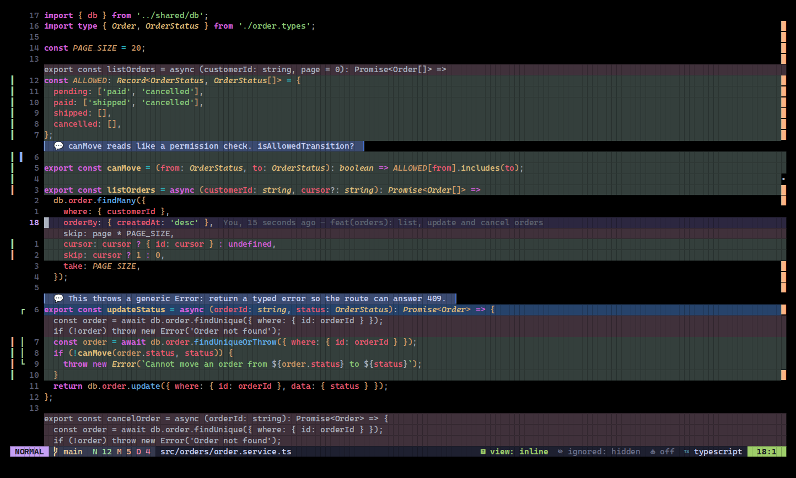
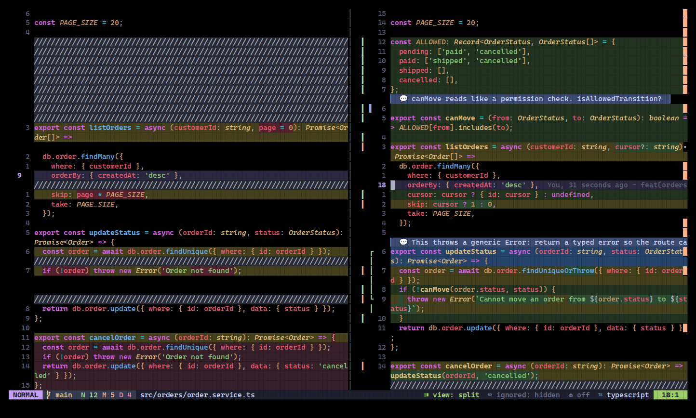
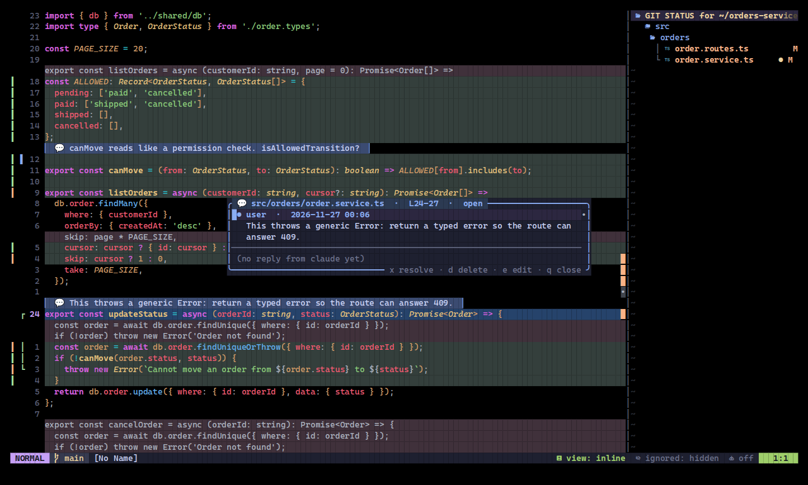
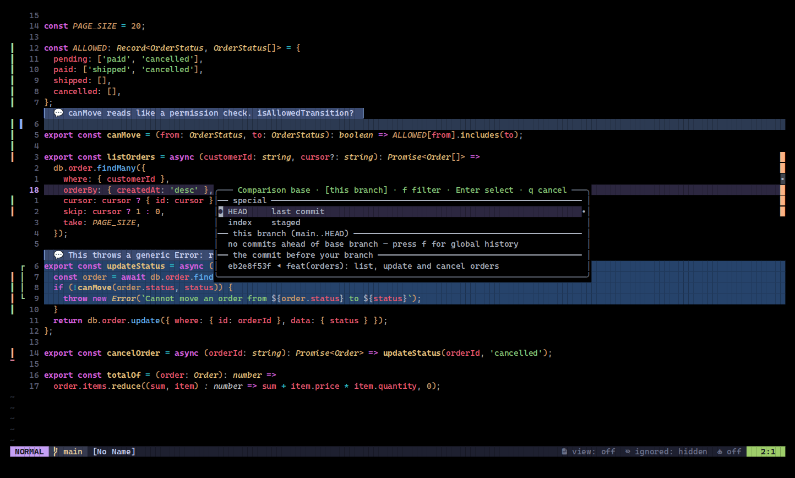

# review-mode.nvim

Code review inside Neovim. Comment on lines, see what changed against HEAD or any commit, and hand
the comments to an AI agent, without leaving the buffer you are editing.

Everything is drawn on top of the real file (extmarks, virtual lines and the status column), so you
keep typing with your LSP, treesitter and keymaps while you review.



## Features

- **Comments on lines and ranges.** Multi-line comments anchored with extmarks, so they follow the
  code as you edit. Nested brackets in the gutter show where each one starts and ends, and a peek
  card shows the full thread.
- **Three views of the same file.** Normal, inline (a unified diff with deleted lines drawn in
  place) and split (two columns with Neovim's native diff, aligned VSCode style).
- **Any base.** Compare against HEAD, the index or any commit (`:ReviewBase`); the views, the
  scrollbar markers and gitsigns follow it.
- **Changed-files sidebar.** A neo-tree view that toggles between changed files and the whole
  project.
- **Agent-ready export.** Yank the comments of a file or the whole repo as Markdown with
  `path:line` anchors, ready to paste into an AI agent.
- **Two-way agent bridge (optional).** An RPC API lets an agent reply to and resolve comments, and
  edits it makes on disk are patched into open buffers without losing the comments' anchors.

Comments are stored per repository in `.git/review.nvim/comments.json`, so they never end up in a
commit.

### Screenshots

The split view, with the last commit on the left and the file you are editing on the right:



The peek card of a comment, with its thread and the actions on it:



Picking what to compare against:



These are real captures of the plugin in a small demo project.

## Install

With [lazy.nvim](https://github.com/folke/lazy.nvim):

```lua
{
  "El-Vitas/review-mode.nvim",
  dependencies = {
    "nvim-lua/plenary.nvim",
    "MunifTanjim/nui.nvim",
    "nvim-neo-tree/neo-tree.nvim", -- optional: the changed-files sidebar
  },
  config = function()
    require("review").setup()
  end,
}
```

Requires Neovim 0.12+ and git. The optional
[nvim-scrollbar](https://github.com/petertriho/nvim-scrollbar) (v1) shows change markers.

## Usage

All keymaps live under `<leader>r` (change it with `setup({ leader = "..." })`).

| Keys | Action |
|---|---|
| `<leader>rc` | Comment the line or the visual selection |
| `<leader>re` / `rd` / `rx` | Edit / delete / resolve the comment under the cursor |
| `<leader>rp` | Peek card with the full thread |
| `<leader>rl` / `rL` | List every comment / the ones in this file |
| `<leader>rv` | Cycle normal → inline → split |
| `<leader>rn` / `ri` / `rs` | Normal / inline / split view |
| `<leader>rb` | Pick the comparison base |
| `]r` / `[r` | Next / previous change |
| `<leader>ryf` / `rya` | Yank this file's comments / all comments for an agent |
| `<leader>ra` | Toggle the agent bridge |

Every command also has a short alias (`:ReviewList` is `:Rl`). The full reference is in
`docs/commands.md`.

## Tests

```bash
nvim --headless -c "PlenaryBustedDirectory tests/ {minimal_init='tests/minimal_init.lua'}" -c "qa"
bash tests/e2e/run.sh   # end-to-end, with a real config and a throwaway repo
```

## Documentation

`docs/README.md` is the index: architecture, features, the full command reference, highlight
groups, performance notes, the decision log and the roadmap. `DESIGN.md` explains the idea behind the
plugin, and `docs/plans/` keeps the original implementation plans.

## License

MIT
